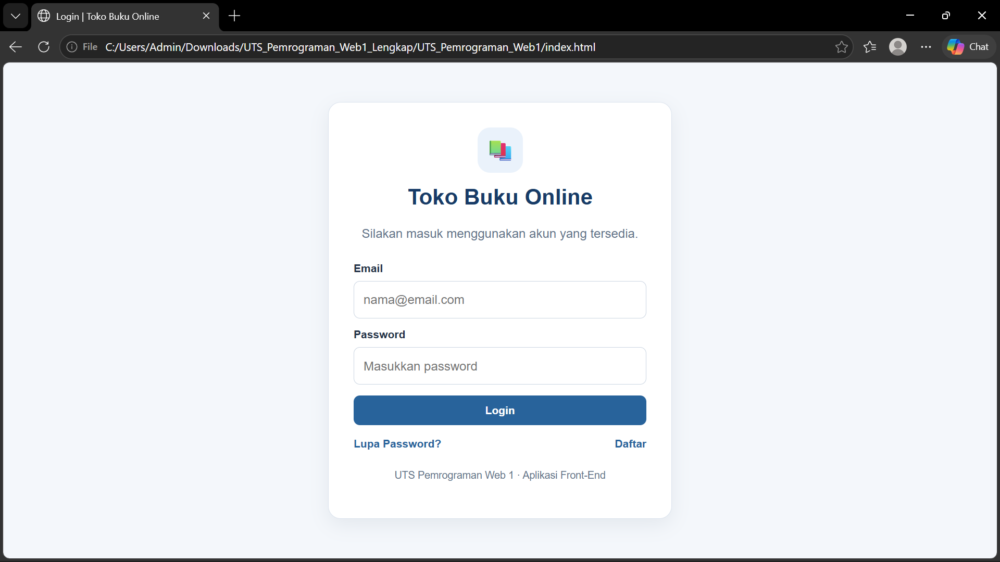
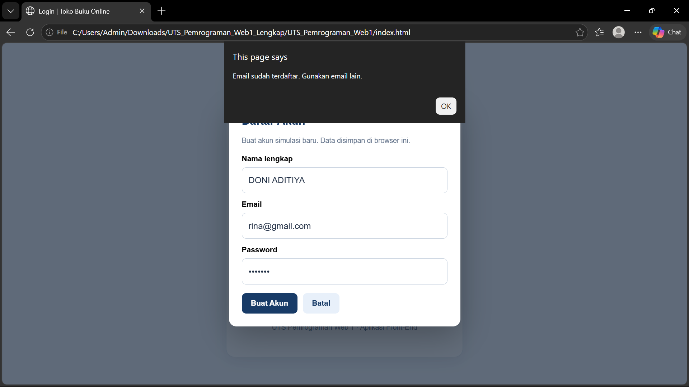
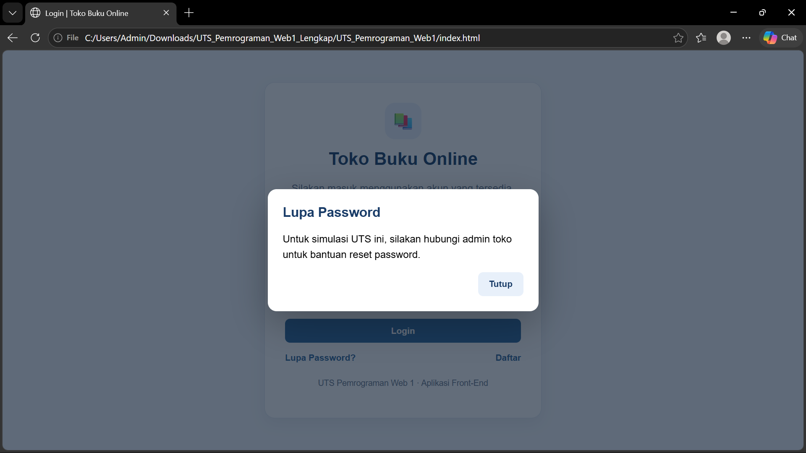
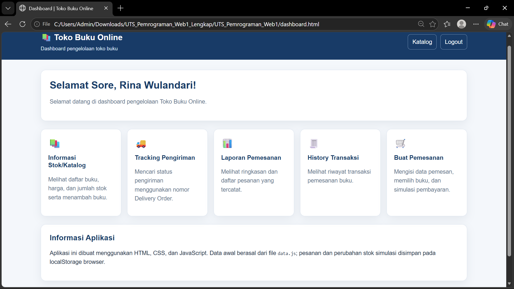
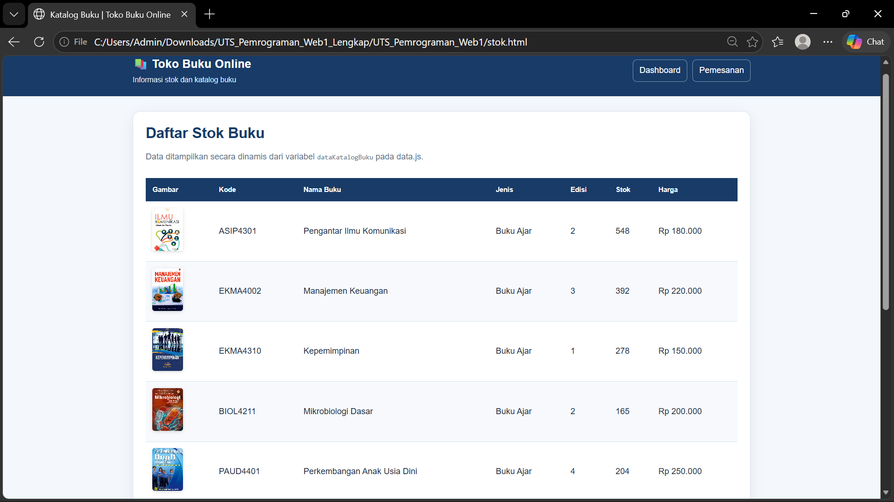
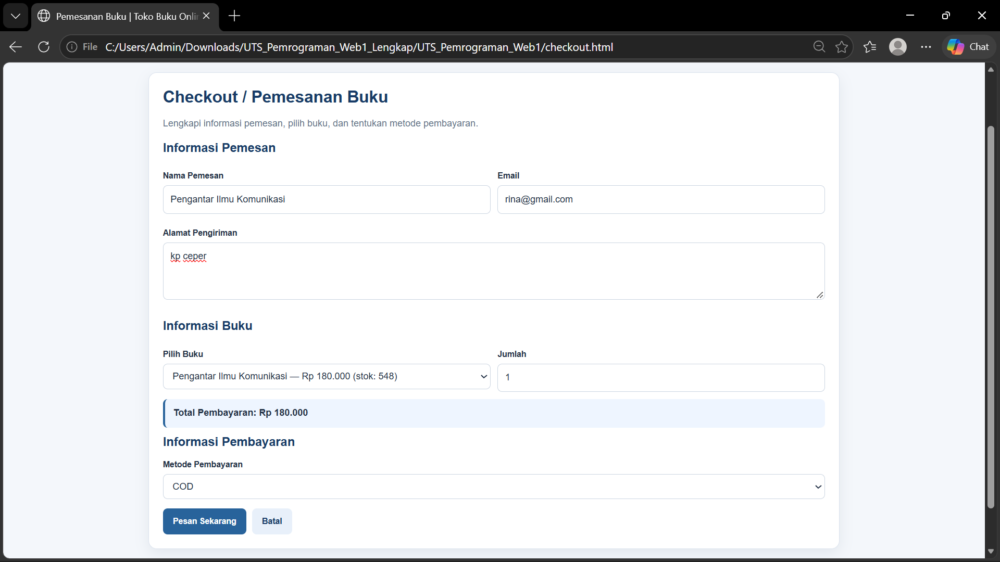
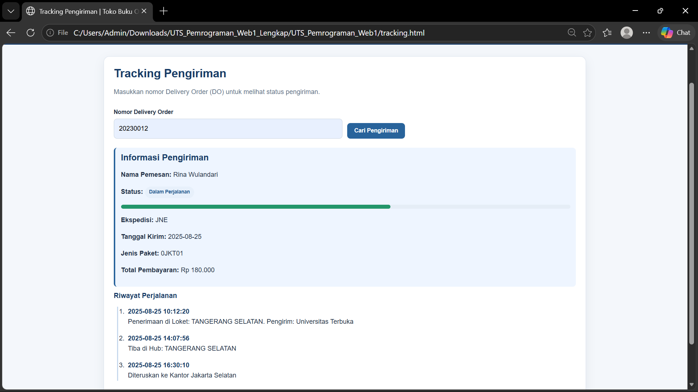
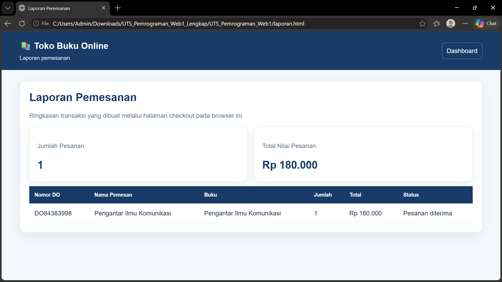

# TOKO BUKU ONLINE
### Project Ujian Tengah Semester – Pemrograman Web 1

## 1. Deskripsi Project
Toko Buku Online merupakan project website sederhana untuk memenuhi tugas Ujian Tengah Semester mata kuliah Pemrograman Web 1. Website ini menyediakan fitur login, pendaftaran akun, dashboard, daftar stok buku, checkout, tracking pesanan, laporan, dan riwayat transaksi.

Project dibuat menggunakan HTML, CSS, dan JavaScript. Data disimpan pada browser menggunakan Local Storage dan/atau Session Storage sesuai implementasi program.

## 2. Tujuan Project
1. Menerapkan HTML untuk struktur halaman website.
2. Menerapkan CSS untuk mengatur tampilan website.
3. Menerapkan JavaScript untuk fungsi dan interaksi.
4. Membuat simulasi pengelolaan stok buku dan transaksi.
5. Menampilkan informasi laporan dan riwayat transaksi.

## 3. Teknologi yang Digunakan
- HTML
- CSS
- JavaScript
- Local Storage / Session Storage
- Visual Studio Code
- Live Server

## 4. Struktur Folder Project
```text
UTS_Pemrograman_Web1/
├── index.html
├── dashboard.html
├── stok.html
├── checkout.html
├── tracking.html
├── laporan.html
├── history.html
├── README.md
├── css/
│   └── style.css
├── js/
│   ├── data.js
│   └── app.js
├── img/
└── ss-program/
    ├── login.png
    ├── register.png
    ├── lupa-password.png
    ├── dashboard.png
    ├── stok.png
    ├── checkout.png
    ├── checkout-berhasil.png
    ├── tracking.png
    ├── laporan.png
    └── history.png
```

## 5. Fitur Website
### A. Login
Digunakan untuk masuk ke website menggunakan email dan password akun.

### B. Register
Digunakan untuk mendaftarkan akun baru melalui form yang tersedia.

### C. Lupa Password
Menyediakan tampilan/form bantuan ketika pengguna lupa password.

### D. Dashboard
Menjadi halaman utama setelah pengguna berhasil login dan menyediakan navigasi ke fitur website.

### E. Stok Buku
Menampilkan daftar buku beserta informasi buku dan jumlah stok yang tersedia.

### F. Checkout
Digunakan untuk mengisi data pelanggan, memilih buku, menentukan jumlah pembelian, memilih pembayaran, dan melihat total harga. Setelah transaksi berhasil, sistem menyimpan transaksi dan memperbarui stok sesuai implementasi program.

### G. Tracking Pesanan
Digunakan untuk mencari informasi pesanan menggunakan nomor DO atau nomor pesanan.

### H. Laporan
Menampilkan ringkasan informasi transaksi atau penjualan yang tersedia pada sistem.

### I. History
Menampilkan daftar transaksi yang telah dilakukan.

## 6. Cara Menjalankan Website
1. Buka Visual Studio Code.
2. Pilih **File → Open Folder**.
3. Pilih folder project `UTS_Pemrograman_Web1`.
4. Buka file `index.html`.
5. Klik kanan pada file tersebut.
6. Pilih **Open with Live Server**.
7. Browser akan terbuka dan website siap digunakan.

## 7. Akun Demo
| Email | Password |
|---|---|
| `rina@gmail.com` | `rina123` |
| `agus@gmail.com` | `agus123` |
| `siti@gmail.com` | `siti123` |

Gunakan akun yang tersedia di dalam program untuk mencoba login.

## 8. Panduan Penggunaan Website
1. **Login:** buka website, masukkan email dan password, lalu klik Login.
2. **Register:** dari halaman login, pilih Register/Daftar dan isi form yang tersedia.
3. **Lupa Password:** dari halaman login, pilih Lupa Password dan ikuti form yang ditampilkan.
4. **Dashboard:** setelah login berhasil, pengguna diarahkan ke dashboard.
5. **Stok:** pilih menu Stok untuk melihat daftar buku dan persediaannya.
6. **Checkout:** buka menu Checkout, isi data pelanggan, pilih buku, masukkan jumlah, pilih pembayaran, periksa total, lalu proses transaksi.
7. **Tracking:** buka menu Tracking, masukkan nomor DO, lalu lakukan pencarian.
8. **Laporan:** buka menu Laporan untuk melihat ringkasan transaksi/penjualan.
9. **History:** buka menu History untuk melihat transaksi yang sudah tersimpan.

## 9. Dokumentasi Screenshot Program
Klik tautan **Buka screenshot** untuk membuka gambar secara langsung. Gambar juga ditampilkan di bawah setiap tautan jika README dibuka pada aplikasi yang mendukung tampilan Markdown.

### 1. Halaman Login
[Buka screenshot Login](ss-program/login.png)

[](ss-program/login.png)

### 2. Halaman Register
[Buka screenshot Register](ss-program/register.png)

[](ss-program/register.png)

### 3. Halaman Lupa Password
[Buka screenshot Lupa Password](ss-program/lupa-password.png)

[](ss-program/lupa-password.png)

### 4. Halaman Dashboard
[Buka screenshot Dashboard](ss-program/dashboard.png)

[](ss-program/dashboard.png)

### 5. Halaman Stok Buku
[Buka screenshot Stok Buku](ss-program/stok.png)

[](ss-program/stok.png)

### 6. Halaman Checkout
[Buka screenshot Checkout](ss-program/checkout.png)

[](ss-program/checkout.png)

### 7. Transaksi Berhasil
[Buka screenshot Transaksi Berhasil](ss-program/checkout-berhasil.png)

[](ss-program/checkout-berhasil.png)

### 8. Halaman Tracking
[Buka screenshot Tracking](ss-program/tracking.png)

[](ss-program/tracking.png)

### 9. Halaman Laporan
[Buka screenshot Laporan](ss-program/laporan.png)

[](ss-program/laporan.png)

### 10. Halaman History
[Buka screenshot History](ss-program/history.png)

[](ss-program/history.png)

**Catatan:** Screenshot struktur folder VS Code belum disertakan dalam ZIP yang diterima. Jika diperlukan, ambil screenshot panel Explorer VS Code dan simpan sebagai `ss-program/struktur-folder.png`, lalu tambahkan tautan `[Buka screenshot Struktur Folder](ss-program/struktur-folder.png)`.

## 10. Langkah Mengambil Screenshot
1. Jalankan website menggunakan Live Server.
2. Buka halaman yang ingin didokumentasikan.
3. Tekan `Windows + Shift + S`.
4. Pilih area layar yang ingin diambil.
5. Simpan gambar dengan nama yang sesuai pada folder `ss-program`.
6. Pastikan nama file sama persis dengan nama yang ditulis pada tautan README.

Screenshot yang disarankan:
- `login.png`: halaman login.
- `register.png`: form pendaftaran.
- `lupa-password.png`: form lupa password.
- `dashboard.png`: halaman dashboard.
- `stok.png`: daftar buku dan stok.
- `checkout.png`: form checkout sebelum transaksi diproses.
- `checkout-berhasil.png`: tampilan transaksi berhasil.
- `tracking.png`: hasil pencarian nomor DO.
- `laporan.png`: halaman laporan.
- `history.png`: daftar riwayat transaksi.

## 11. Pengujian Website
Pengujian dilakukan dengan mencoba login, membuka form register dan lupa password, melihat dashboard, memeriksa stok, melakukan checkout, memeriksa perubahan stok, mencari pesanan melalui nomor DO, serta melihat laporan dan riwayat transaksi.

## 12. Penyimpanan Data
Project ini menggunakan penyimpanan browser (Local Storage dan/atau Session Storage) sesuai implementasi program. Project ini merupakan simulasi front-end dan tidak menggunakan database server terpisah.

## 13. Kelebihan dan Kekurangan
### Kelebihan
1. Memiliki beberapa halaman dan menu yang saling terhubung.
2. Menyediakan simulasi login dan pendaftaran.
3. Menyediakan informasi stok buku.
4. Memiliki alur transaksi checkout.
5. Menyediakan tracking, laporan, dan riwayat transaksi.

### Kekurangan
1. Masih berupa aplikasi front-end.
2. Data tersimpan pada browser.
3. Belum menggunakan database server.
4. Belum terhubung langsung dengan layanan pembayaran atau pengiriman.

## 14. Kesimpulan
Website Toko Buku Online merupakan project sederhana untuk menerapkan HTML, CSS, dan JavaScript dalam pembuatan website interaktif. Fitur yang tersedia mencakup login, dashboard, stok buku, checkout, tracking, laporan, dan riwayat transaksi. Project ini masih dapat dikembangkan dengan penambahan backend dan database agar pengelolaan data lebih lengkap.
